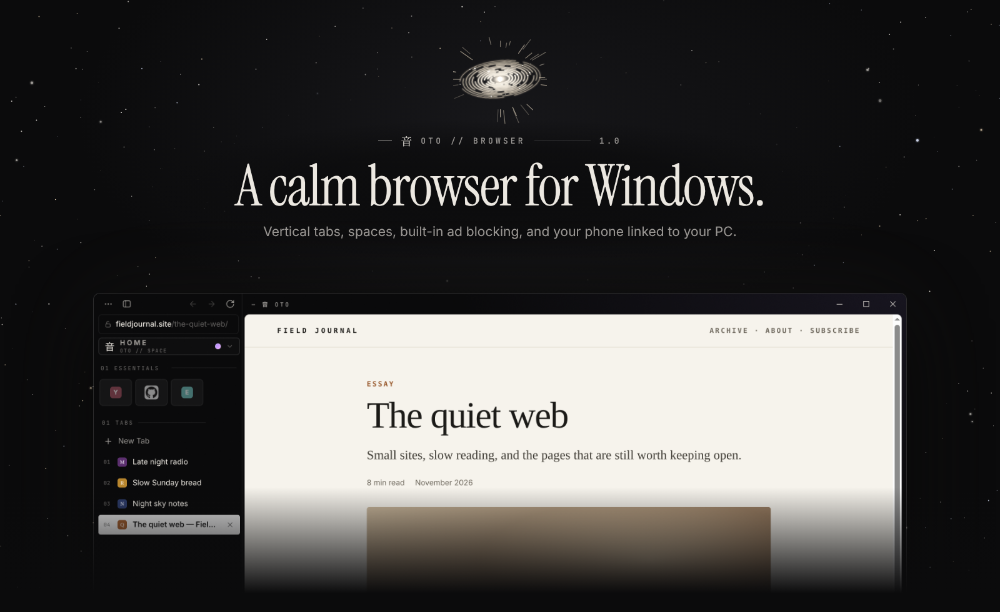
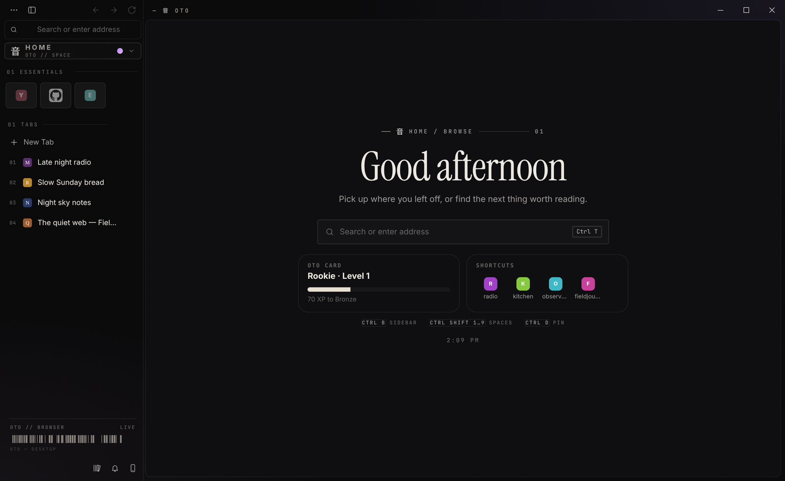
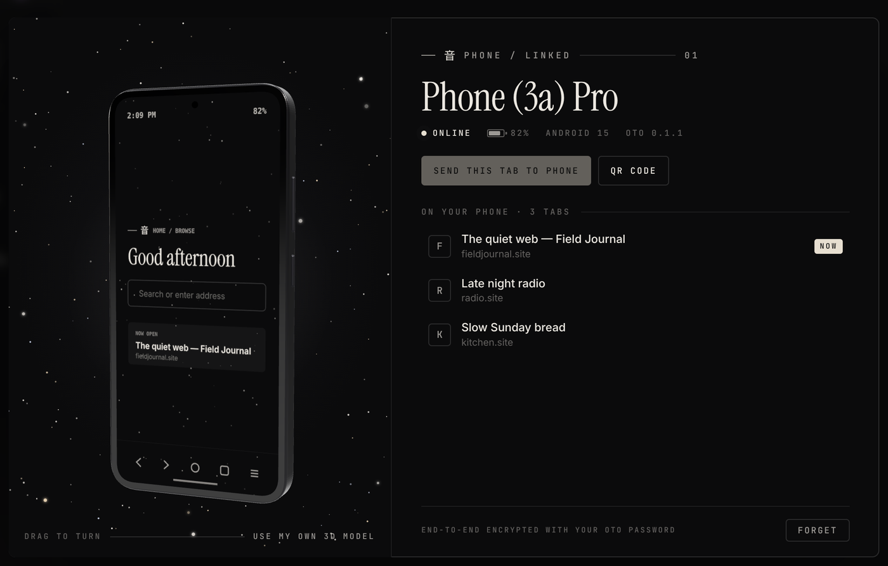
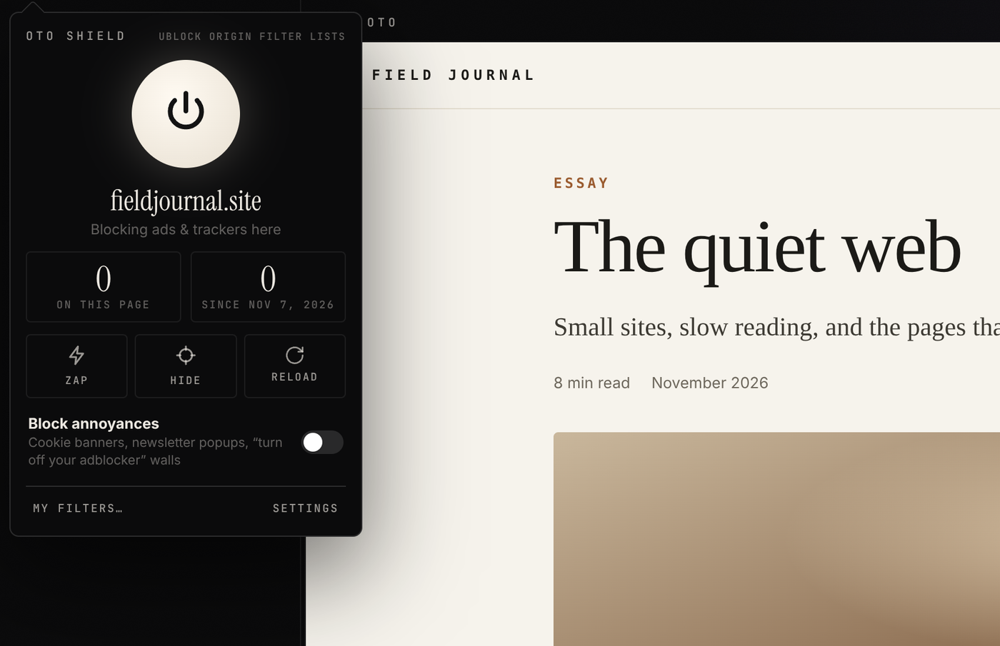
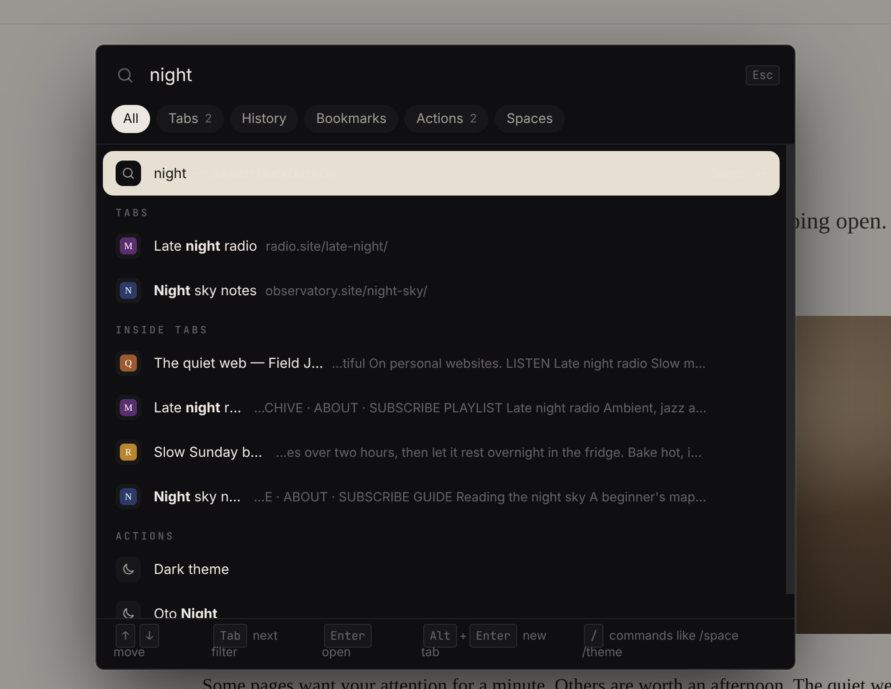
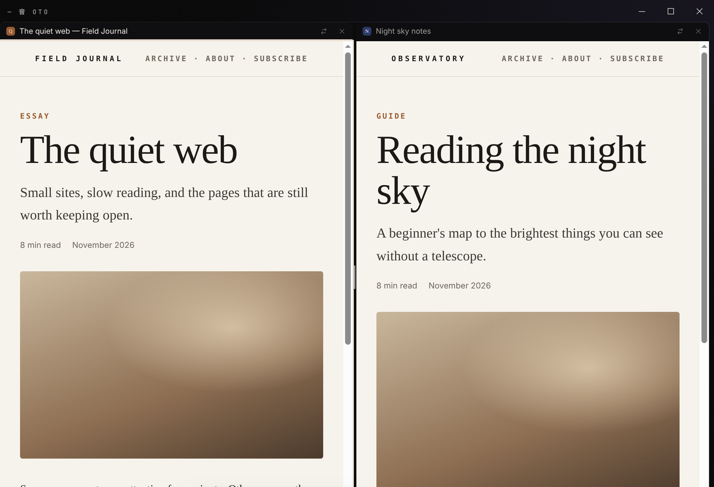
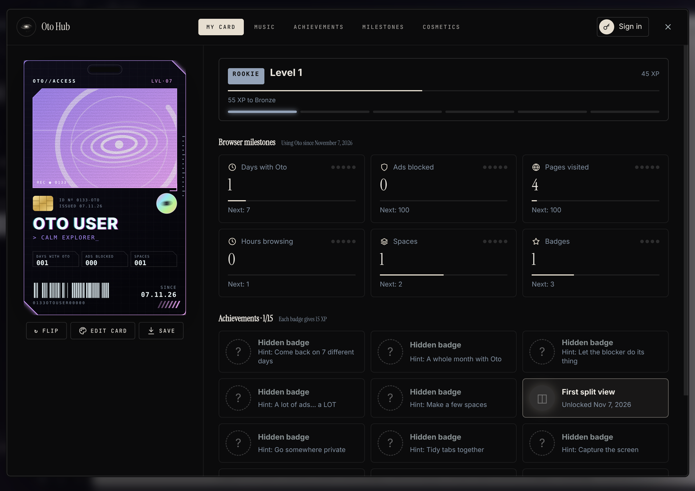
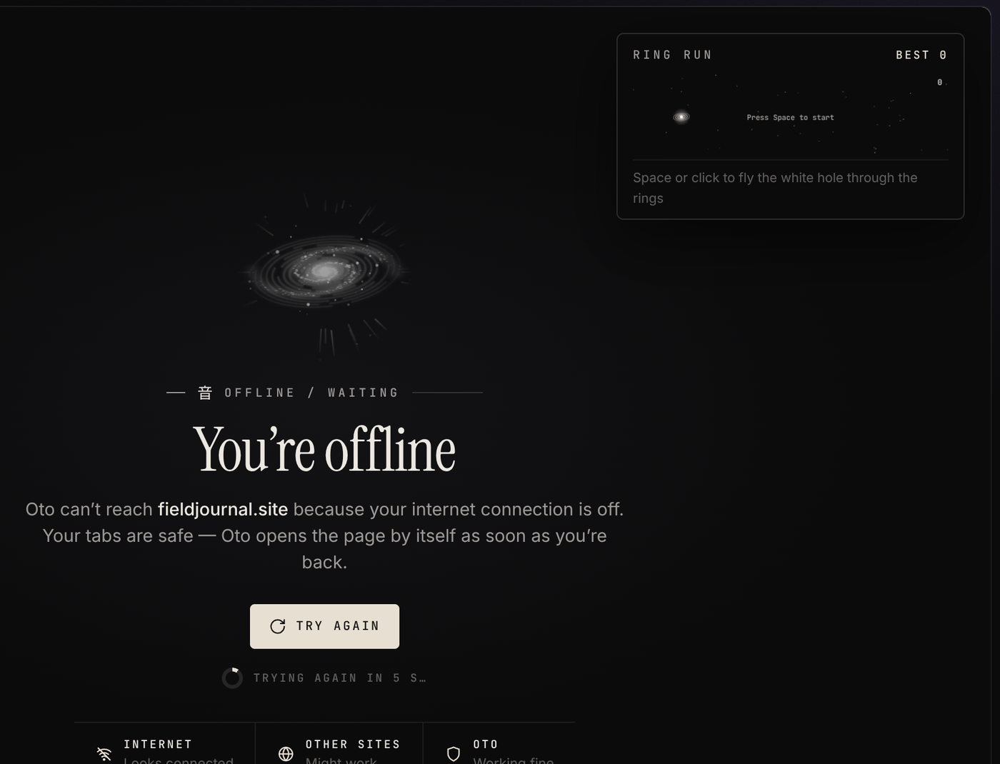
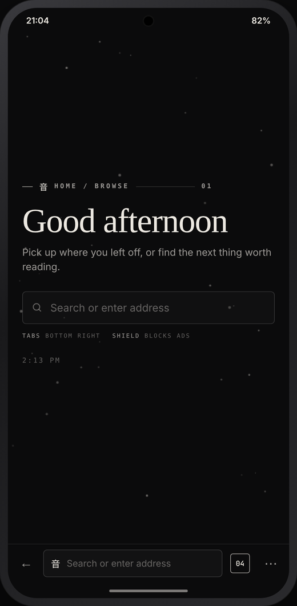

<p align="center"></p>

<p align="center">
  <a href="https://github.com/mukairyo/oto/releases/latest"><b>⬇&nbsp; Download Oto for Windows</b></a>
  &nbsp;·&nbsp; <a href="https://github.com/mukairyo/oto/releases/latest">Oto for Android</a>
  &nbsp;·&nbsp; <a href="CHANGELOG.md">What's new</a>
</p>

<p align="center"><sub>Free · Windows 10 & 11 · Android 8+ · built on Chromium · updates itself</sub></p>

---

## 音 &nbsp;What is Oto?

Oto is a browser that stays out of your way. Your tabs live in a sidebar instead of across the top, grouped into **spaces** for work, school, music or anything else. Ads and trackers are blocked before the page even loads. Your settings, bookmarks and passwords follow you to every PC with an **Oto account**, and your **phone** shows up right inside Oto.

Everything is dressed in one calm look: near-black, cream, thin lines, quiet type. Nothing blinks at you.

<p align="center"></p>

## ✦ &nbsp;Highlights

<table>
<tr>
<td width="50%"><br><b>My phone</b> — sign in to Oto on your Android phone and it appears on your PC in 3D, with its battery and open tabs. Send tabs both ways.</td>
<td width="50%"><br><b>Oto Shield</b> — ad and tracker blocking with uBlock Origin's filter lists. Zap anything on a page, hide it for good, or switch blocking off per site.</td>
</tr>
<tr>
<td><br><b>Command bar</b> (<code>Ctrl T</code>) — search, open sites, jump to any tab, find words inside your open pages, do quick sums, run actions.</td>
<td><br><b>Split view</b> — drag a tab onto the page and get two sites side by side.</td>
</tr>
<tr>
<td><br><b>Oto Hub & Oto Card</b> — your own card that levels up as you browse, with milestones and badges to unlock.</td>
<td><br><b>Even the offline page is nice</b> — Oto reconnects by itself, and you can play Ring Run while you wait.</td>
</tr>
</table>

## ⬇ &nbsp;Install

**Windows**

1. **[Download Oto-Setup-x.y.z.exe](https://github.com/mukairyo/oto/releases/latest)** and run it.
2. Windows SmartScreen may say the app is unrecognised (Oto isn't code-signed yet). Click **More info → Run anyway**.
3. A two-minute setup lets you bring your bookmarks from another browser and pick your layout, speed and privacy. Or sign in to your Oto account to get everything back.

New versions download by themselves. You'll see a small card in the sidebar: **Restart now**.

**Android**



1. On your phone, open the **[latest release](https://github.com/mukairyo/oto/releases/latest)** and download **Oto-Android-x.y.z-arm64.apk**.
2. Open it to install (Android asks once to allow installs from your browser).
3. Tap **⋯ → Oto account** and sign in with the same account as your PC. Your phone appears in **My phone** on the PC within a few seconds.

Oto for Android is new (version 0.1): tabs, Oto Shield, the Oto look, desktop-site mode, and the link with your PC. It updates itself from the app menu.

<br clear="right">

## ◎ &nbsp;Everything else

<details>
<summary><b>Tabs & spaces</b></summary>

- Vertical tabs with **Essentials** (your favourite sites as big icons), pinned tabs and **tab folders**.
- **Spaces** with their own tabs, icon and logins. Switch with `Ctrl+Shift+1…9` or see them all in **Space overview** (`Ctrl+Shift+Space`).
- **Glance** — preview a link in a floating window without leaving the page.
- **Routing** — sites you choose always open in the right space.
- Tabs fall asleep in the background to save memory and wake instantly. **Oto Health** (`Shift+Esc`) shows what's using memory.
</details>

<details>
<summary><b>Privacy & security</b></summary>

- **Oto Shield**: uBlock Origin's filter lists, element zapper, your own filters, annoyance lists for cookie banners and "turn off your adblocker" walls.
- Cookie pop-ups clicked away for you, tracking bits removed when you copy a link.
- **Avocado** 🥑 (`Ctrl+Shift+N`) — a private window that forgets everything when you close it.
- Sites must ask before using your camera, mic, location or notifications. Review it all in the site panel (click the lock).
- Chromium security fixes arrive automatically: a daily job ships them as small updates.
</details>

<details>
<summary><b>Oto account & sync</b></summary>

- Settings, themes, bookmarks, spaces, your Oto Card and passwords on every PC.
- **End-to-end encrypted**: everything is locked with your password on your PC before it's uploaded. The server only ever sees scrambled data.
- Forgot your password? Oto emails you a code you type right in Oto.
- Your phone links through the same account, with the same encryption.
</details>

<details>
<summary><b>Make it yours</b></summary>

- Customize the sidebar buttons, layout, tab height, fonts, animations and shortcuts.
- **Boosts** restyle any website with your own CSS; **Mods** restyle Oto itself.
- **Theme maker** for your space colours, **Oto sounds**, a startup animation and sound.
- Extensions from the Chrome Web Store just work (plus `.crx`, `.xpi` and `.zip`).
- Streaming sites with protected video (Spotify, Netflix, Disney+, Prime Video…) play normally.
</details>

<details>
<summary><b>Little things</b></summary>

- Screenshots with drawing and blur (`Ctrl+Shift+X`), site notes, picture-in-picture and video speed controls.
- Notification center with Do not disturb, battery saver for laptops, Oto Night.
- **Oto Wrapped** — a story of how you use Oto (type "wrapped" in the command bar).
- Hold `Ctrl` for a second to see every shortcut.
- Backup and restore your whole Oto as one file.
</details>

## ⌨ &nbsp;Shortcuts

| | |
|---|---|
| New tab / command bar | `Ctrl+T` |
| Edit address | `Ctrl+L` |
| Close / reopen tab | `Ctrl+W` / `Ctrl+Shift+T` |
| Next / previous tab | `Ctrl+Tab` / `Ctrl+Shift+Tab` |
| Space 1–9 | `Ctrl+Shift+1…9` |
| Space overview | `Ctrl+Shift+Space` |
| Show / hide sidebar | `Ctrl+B` |
| Split view | `Ctrl+Shift+S` |
| Screenshot | `Ctrl+Shift+X` |
| Oto Health | `Shift+Esc` |
| Avocado (private window) | `Ctrl+Shift+N` |
| Library | `Ctrl+Shift+O` |
| Settings | `Ctrl+,` |
| All shortcuts | hold `Ctrl` |

## 🧪 &nbsp;Testing Oto (Beta and Alpha)

Want new things early? In Oto, open **Settings → About & updates → Update channel**:

| Channel | You get |
|---|---|
| **Stable** | tested versions — what everyone has |
| **Beta** | new versions before everyone else; mostly stable |
| **Alpha** | the newest experiments as soon as they exist; things can break |

Found a bug? Use **Settings → About & updates → Report a problem** and send the file, or open an [issue](https://github.com/mukairyo/oto/issues).

<details>
<summary><b>Run from source</b></summary>

Needs [Node.js](https://nodejs.org) 20 or newer.

```
npm install
npm start
```

Build the Windows installer into `dist/` with `npm run dist`. Oto for Android lives on the [`android`](https://github.com/mukairyo/oto/tree/android/android) branch (Kotlin + GeckoView) and is built by GitHub Actions.

- `main.js` — window, shortcuts, menus, ad blocking, permissions, downloads, updates
- `account.js` — Oto accounts, encrypted sync and the phone link
- `preload.js` — safe bridge between the UI and the main process
- `src/` — the browser UI (`index.html`, `renderer.js`, `v1*.js`, styles)
</details>

<details>
<summary><b>Releasing a new version</b></summary>

1. Add a section for the version at the top of `CHANGELOG.md` (`## 1.0.2 — date`, then **New** / **Fixed** / **Changed** lists).
2. Set `version` and `otoVersion` in `package.json` to the same number and push to `main`. Tester builds use a pre-release number like `1.1.0-beta.1`.
3. The **Build & release** action builds the installer and publishes release `v1.0.2` with that changelog section as its notes. Everyone's Oto picks it up by itself.

Android: bump `android/VERSION` on the `android` branch. The APK is signed with the Oto key and added to the newest Oto release.
</details>

## Known limits

- Google sometimes blocks sign-in from Chromium-based apps it doesn't recognise ("This browser or app may not be secure"). Oto works around it, but it can still happen.
- Not code-signed yet, so Windows SmartScreen shows a warning the first time.

<p align="center"><br><br><sub>音 &nbsp;Oto — made by <a href="https://github.com/mukairyo">mukairyo</a></sub></p>
