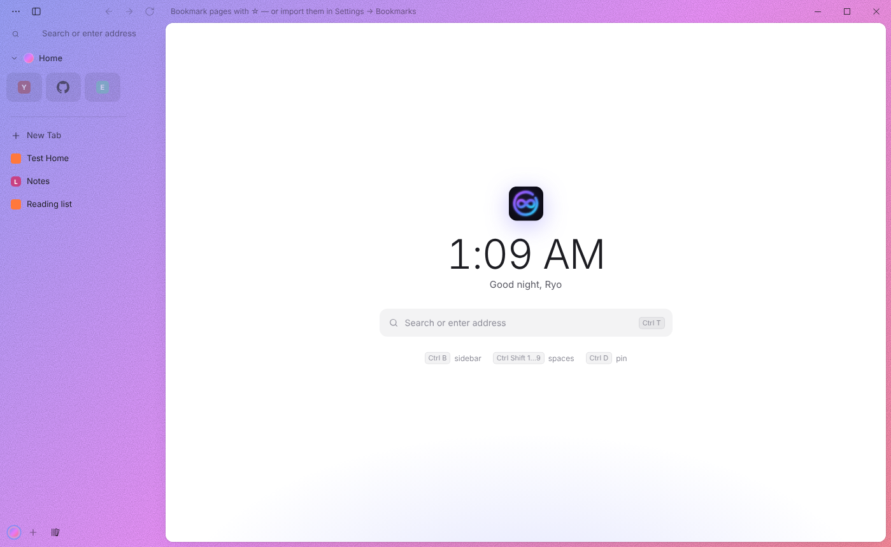
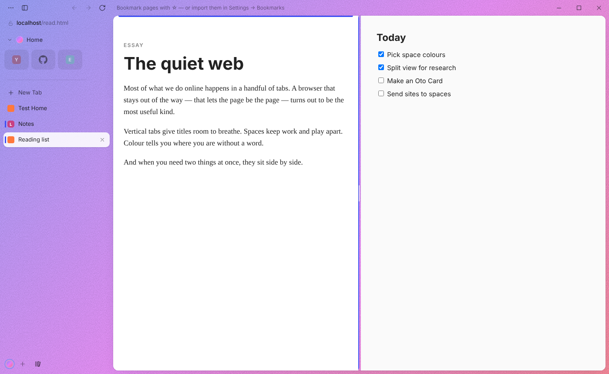
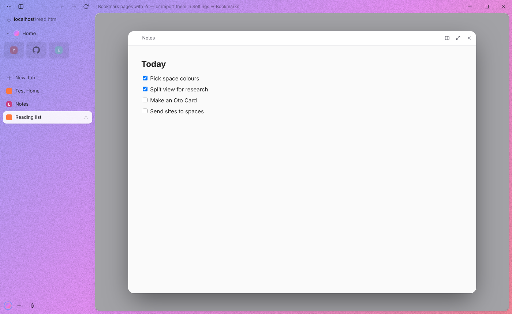
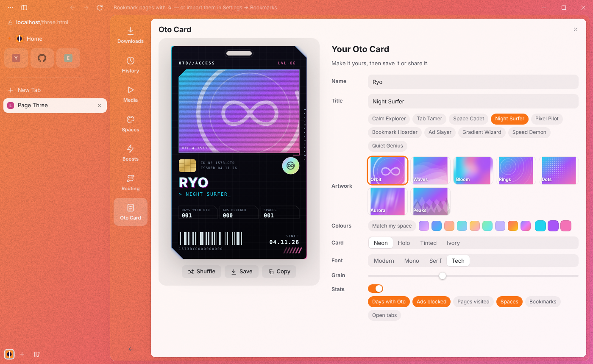
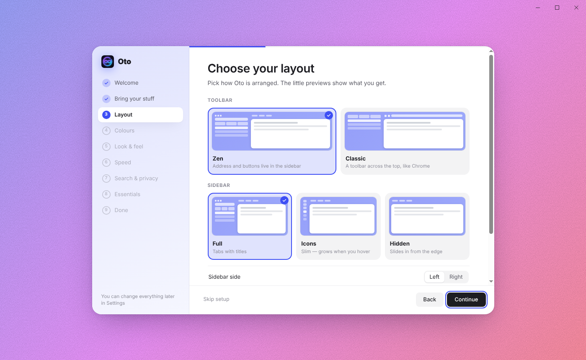

<p align="center"></p>

<h1 align="center">Oto</h1>

<p align="center"><b>A calm, customisable web browser for Windows.</b><br>
Vertical tabs and spaces with their own colours like Zen, a command bar like Dia, Arc-style settings and Helium-style privacy — built on Chromium.</p>

<p align="center"><a href="https://github.com/mukairyo/oto/releases/latest"><b>⬇ Download Oto for Windows</b></a> · <a href="CHANGELOG.md">What's new</a></p>

<p align="center"></p>

## What is Oto?

Oto is a browser that stays out of your way. Your tabs live in a sidebar instead of across the top, grouped into **spaces** — each with its own gradient that tints the whole window, so you always know where you are. Everything can be changed: the layout, colours, animations, how the sidebar behaves, even the app icon. Ads and trackers are blocked out of the box, and Oto **updates itself**.

| | |
|---|---|
|  **Split view** — two tabs side by side |  **Glance** — preview a link without leaving the page |
|  **Oto Card** — your own customisable card |  **Custom setup** — make it yours in two minutes |

## Install

1. **[Download the latest Oto-Setup-x.y.z.exe](https://github.com/mukairyo/oto/releases/latest)** and run it.
2. Windows SmartScreen may say the app is unrecognised (it isn't code-signed yet) — click **More info → Run anyway**.
3. On first launch a short setup walks you through importing bookmarks, your layout, colours, speed, privacy and favourite sites.

After that, new versions download in the background and install when you restart. See **[CHANGELOG.md](CHANGELOG.md)** for what each version added and fixed — the same notes appear on every [release](https://github.com/mukairyo/oto/releases).

## Features

- **Updates itself**: Oto checks this repo's releases, downloads new versions in the background and installs them when you restart (Settings → About → Updates).
- **Library** (`Ctrl+Shift+O`): Downloads, History, Media, Spaces, Boosts, Routing and your Oto Card in one panel.
- **Downloads** with a glowing orb that flies from your cursor into the downloads button (progress ring, count badge, a tick when done), and a live card at the bottom of the sidebar — progress, speed, pause/cancel, open or show in folder (`Ctrl+J` for all downloads).
- **Routing**: send sites to the space they belong in — links to them open there automatically.
- **Oto Card**: your own card in three designs — a cyberpunk **Keycard**, the **Classic** card or a holographic **Shiny** card — with name, title, artwork, colours, styles, font, grain and stats. The preview tilts and shines under your mouse. Shuffle it, save it as an image or copy it.
- **Split view** (`Ctrl+Shift+S`): two tabs side by side — drag the divider, double-click to even it out, click either half to work in it. Right-click a tab → *Split with current tab*.
- **Glance**: hold `Alt` to see which link will open, then `Alt + click` it (or right-click → *Open link in Glance*) to preview it in a floating window; open it as a tab or in split view from there.
- **Media controls** in the sidebar for whatever is playing — play/pause, mute, picture-in-picture (`Ctrl+Shift+P`).
- **Report a problem** (Settings → About): saves a small log of what the sidebar, top bar and mouse did, to send when something misbehaves.
- **Zen layout** (default): back/forward, reload, the address and a ··· menu live in the sidebar; a slim top strip holds the bookmarks bar, extension buttons and Oto's own window buttons. Switch to a classic top toolbar in Settings → Appearance.
- **Dynamic sidebar** (default): a slim icon rail that grows into the full sidebar when you hover it, pushing the page over so it stays connected to the top bar. The sidebar button switches between collapsed and expanded.
- **Zen-strength colours**: your space colours are used at full strength and the sidebar/top text switches between light and dark automatically.
- **Drag the sidebar edge** to resize — drag it narrow and it snaps to icons, keep going and it hides; pull it back out from the screen edge. Hidden sidebars also grow in place when you touch the edge.
- **Sidebar settings**: icon-strip width, snap points for drag-to-resize, hover open delay, how long until it goes back — or keep it open until you click the page. Collapsed or hidden sidebars keep the Zen layout (navigation shows when the sidebar slides open), or you can move navigation to the top bar.
- **Auto-hide** the top bar (Ctrl+Shift+B) and the sidebar (Ctrl+B) — they slide away and come back when you touch the screen edge. Animations: Off / Smooth / Playful / Custom — with a curve editor (drag two handles), speed slider, presets and a live preview.
- **Extensions**: install from the Chrome Web Store (“Add to Chrome” just works), or add .crx (Chrome/Opera), .xpi (Firefox) and .zip files or unpacked folders. Popups, badges, context-menu items and the `chrome.tabs` API are supported.
- **Bookmarks bar** with folders and overflow, ☆ in the address row, and import from Chrome, Edge, Brave, Opera, Opera GX, Vivaldi, Zen and Firefox — or any exported HTML file.
- **Vertical tab sidebar** — Essentials grid (global favourites), pinned tabs, and a tab list. Drag tabs to reorder, pin, add to Essentials, or drop them on another space.
- **Spaces** — separate sets of tabs, each with its own gradient that tints the whole window (Zen-style), and an emoji or your own image as its icon. Switch with the dots at the bottom or `Ctrl+Shift+1…9`.
- **Colour wheel** — right-click a space dot → *Change colours*. Click the wheel to add up to 3 colours, drag the dots, pick a preset, and set intensity and grain. The window updates live.
- **Welcome setup** — runs on first launch; run it again from Settings → About.
- **Command bar** (`Ctrl+T` / `Ctrl+L`) — search, open URLs, jump to open tabs, history, and actions like "Dark theme" or "New space".
- **Compact mode** (`Ctrl+B`) — hide the sidebar; hover the left edge to peek.
- **Privacy** — ads & trackers blocked with EasyList + EasyPrivacy (Ghostery engine), DuckDuckGo by default, sites must ask before using your camera, mic, location, or notifications.
- **Arc-style settings** (`Ctrl+,`) with General, Appearance, Tabs, Privacy, Boosts, Archive, App icon, Shortcuts and About pages:
  - Set Oto as your Windows default browser
  - Continue where you left off, or start fresh each launch
  - Sidebar on the left or right, floating or edge-to-edge pages, address bar shows domain / path / full URL
  - Auto-archive unpinned tabs after 12h–30 days, and a searchable Archive of closed tabs
  - Memory saver that puts background tabs to sleep
  - New-tab position, and Ctrl+Tab by sidebar order or last-used
  - Global Privacy Control / Do Not Track, per-site permissions you can review and reset, clear cookies on exit
  - Ask where to save downloads
  - **Boosts**: restyle any site with your own CSS (templates included, like hiding YouTube Shorts)
  - Choose the app icon shown in the taskbar
- **Performance**: freezes background tabs after a few minutes (zero CPU, instant wake-up), sleeps old tabs to free RAM, presets (Balanced / Low memory / Keep everything running), a live task manager with per-tab memory and CPU, and hardware-acceleration / smooth-scrolling switches.
- **Customise everything**: interface font and size, tab height, page corners and spacing, toolbar buttons, address-bar layout, new-tab page (clock format, greeting with your name, hints), search shortcuts (`yt lofi` searches YouTube — add your own), remappable keyboard shortcuts, **Mods** (built-in UI tweaks plus your own CSS for Oto itself), and export/import of your whole setup.
- Find in page, zoom, mute tabs, unload tabs to save memory, downloads to your Downloads folder, light/dark/system theme, tabs restored on restart.

## Shortcuts

| | |
|---|---|
| New tab / command bar | `Ctrl+T` |
| Edit address | `Ctrl+L` |
| Close / reopen tab | `Ctrl+W` / `Ctrl+Shift+T` |
| Next / previous tab | `Ctrl+Tab` / `Ctrl+Shift+Tab` |
| Tab 1–9 | `Ctrl+1…9` |
| Space 1–9 | `Ctrl+Shift+1…9` |
| Toggle sidebar | `Ctrl+B` |
| Pin / Essentials | `Ctrl+D` / `Ctrl+Shift+D` |
| Find | `Ctrl+F` |
| Copy link | `Ctrl+Shift+C` |
| Zoom | `Ctrl + = / - / 0` |
| Split view | `Ctrl+Shift+S` |
| Picture in picture | `Ctrl+Shift+P` |
| Glance a link | `Alt + click` |
| Library | `Ctrl+Shift+O` |
| Downloads | `Ctrl+J` |
| Settings | `Ctrl+,` |
| Dev tools | `F12` |

## Run from source

Needs [Node.js](https://nodejs.org) 20 or newer.

```
npm install
npm start
```

Build the installer into `dist/`:

```
npm run dist
```

## Project layout

- `main.js` — window, keyboard shortcuts, context menus, ad blocking, permissions, downloads
- `preload.js` — safe bridge between the UI and main process
- `src/index.html`, `src/styles.css`, `src/renderer.js` — the browser UI
- `blocklist.js` — small fallback tracker list used if the full filter lists can't load
- `build/` — app icon

## Releasing a new version

1. Add a section for the new version at the top of `CHANGELOG.md` (`## 1.2.3 — date`, then **New** / **Fixed** lists).
2. Bump `version` in `package.json` and push to `main`.

The **Build & release** GitHub Action builds the Windows installer, publishes release `v1.2.3` with that changelog section as its notes, and everyone's Oto picks it up automatically. Editing an older changelog entry updates that release's notes on the next push.

## Known limits

- Google sometimes blocks sign-in from Electron-based browsers ("This browser or app may not be secure"). Oto hides the Electron tag from its user agent to reduce this, but it can still happen.
- Not code-signed, so SmartScreen shows a warning on first run.
